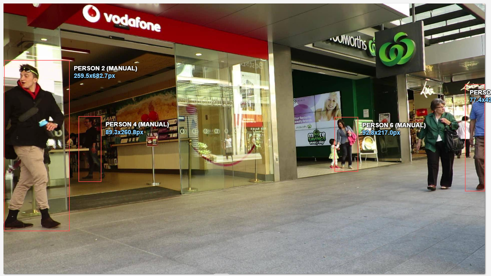
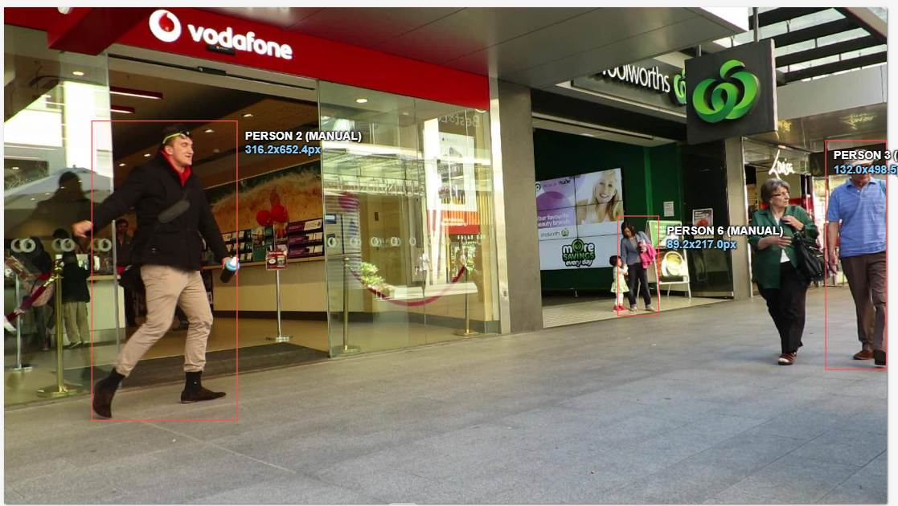
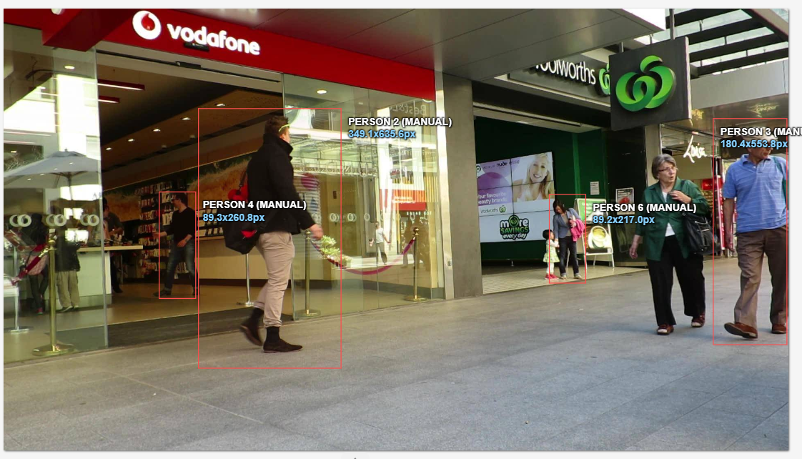

# Báo cáo cá nhân — HoVaTen-MSSV

## 0. Thông tin học viên

- Họ tên: Đỗ Tuấn Long
- MSSV: 2A202604066
- Mã đề (A/B/C): C
- Email: itslongforwork@gmail.com
- Link repository: https://github.com/superuj-coder/K5-L2B-DoTuanLong-2A202604066-MOTTracking
- Giờ bắt đầu: 4h30
- Giờ kết thúc: 7h

## 1. Xem trước đoạn video (CP0)

Ghi **trước khi vẽ**, mỗi người một dòng.

| Mã | Frame xuất hiện | Frame cuối thấy được | Rẽ / dừng / đổi tốc độ ở frame | Bị che ở frame | Ghi chú |
|---|---|---|---|---|---|
| P1 | 1 | 149 | 10 | 42 | ko |
| P2 | 61 | 149 | 90 | ko | xuất hiện xuyên suốt từ frame 61 |
| P3 | 1 | 149 | ko | 1 | Xuất hiện từ frame 1 ở ngoài rìa ảnh |
| P4 | 1 | 111 | 41 | 111 | ko |
| P5 | 21 | 132 | ko | 120 | ko |

## 2. Keyframe và thời gian (CP1, CP4)

Số keyframe lấy từ kết quả `src/check_submission.py`.

| Mã | Số keyframe | Keyframe ở frame | Số frame có mặt | Keyframe / 100 frame | Thời gian (phút) | Chỗ khó |
|---|---|---|---|---|---|---|
| P1 | 16 | 2, 12, 22, 27, 32, 50, 56, 66, 76, 86, 96, 106, 116, 126, 136, 149 | 139 | 11.5 | 15 | Bị che |
| P2 | 7 | 60, 70, 80, 90, 100, 130, 140 | 90 | 7.8 | 15 | ko có |
| P3 | 12 | 3, 13, 33, 43, 73, 93, 103, 113, 123, 133, 143, 149 | 147 | 8.2 | 15 | ko có |
| P4 | 6 | 0, 10, 20, 30, 40, 100 | 110 | 5.5 | 15 | ko có |
| P5 | 22 | 0, 10, 13, 22, 23, 30, 33, 40, 43, 53, 63, 73, 83, 90, 93, 100, 105, 110, 111, 115, 119, 130 | 130 | 16.9 | 15 | ko có |
| **Tổng** | **63** | — | **616** | **10.2** | **75** | P1 bị che |

Keyframe / 100 frame của cả bài = tổng keyframe ÷ tổng số frame có mặt × 100 = 63 ÷ 616 × 100 = **10.2**

Bạn đặt keyframe nhiều nhất ở người nào? Vì sao (người đó rẽ, dừng, lại gần camera hay bị che)?
Tôi đặt keyframe nhiều nhất ở người số 1 vì người đó có rẽ sang trái, sau đó bị che nữa
...

## 3. Đoạn bị che (CP2)

Người bị che: `P1`

| Mốc | Frame |
|---|---:|
| Bắt đầu bị che một phần (bật `occluded`) | 34 |
| Mất hẳn (bật `outside`) | 44 |
| Hiện lại (tắt `outside`) | 54 |
| Thấy rõ trở lại (tắt `occluded`) | 60 |

- Thời gian khuất hẳn: 10 frame = khoảng 0,33 giây (từ frame 44 đến khi hiện lại ở frame 54).
- Quyết định: giữ cùng ID.
- Lý do: P1 khuất hẳn 10 frame, ít hơn ngưỡng 60 frame. Khi hiện lại ở frame 54, tiếp tục track P1 với cùng ID. Kiểm tra ngoại hình, hướng đi và tốc độ tại đoạn hiện lại để xác nhận đây là cùng người.

...

Ảnh chụp màn hình:





## 4. Tự review ID (CP3)


| Frame | Mã người | Loại lỗi | Mô tả một câu | Phát hiện ở lượt | Đã sửa? |
|---:|---|---|---|---|---|
| 0–149 | P1–P5 | — | Đã kiểm hai lượt, không lỗi. | Lượt 1 và lượt 2 | Không có lỗi nên không cần sửa |

Tổng hợp số lỗi theo loại:

| `id_switch` | `fragmentation` | `lost` | `merge` | `false_track` | `drift` | `flag` |
|---:|---:|---:|---:|---:|---:|---:|
| 0 | 0 | 0 | 0 | 0 | 0 | 0 |

Lỗi nào chỉ lượt 2 (theo cảnh) mới thấy, lượt 1 (theo người) không thấy? Vì sao?

Không có lỗi nào ở cả hai lượt nên không có lỗi nào chỉ lượt 2 mới thấy.

...

## 5. File xuất và kết quả tự kiểm (CP4)

| Kiểm tra | Kết quả |
|---|---|
| Tên file MOT 1.1 | `DoTuanLong_mot.zip` |
| Tên file CVAT for video 1.1 | `DoTuanLong_cvat_video.zip` |
| Số track ID khác nhau trong `gt/gt.txt` (phải là 5) | 5 |
| Frame `outside` không có dòng trong `gt.txt` (đúng / sai) | Log ghi các khoảng vắng: track 1 ở frame 120–129; track 3 ở frame 41–49 |
| Job đã completed trên CVAT máy cá nhân | Đã xong |

Dán phần tóm tắt in ra từ `src/check_submission.py`:

```text
Số frame in theo CVAT (bắt đầu từ 0). Trong gt.txt, frame_id = frame CVAT + 1.

=== File MOT 1.1: DoTuanLong_mot.zip ===
  Số track ID: 5   |   Tổng số box: 616
  [OK]        Đúng 5 track ID.

  Track | Frame có mặt | Số frame | Đoạn vắng (outside)
      1 |   0–139      |      130 | 120–129
      2 |   0–109      |      110 | -
      3 |   2–149      |      139 | 41–49
      4 |   3–149      |      147 | -
      5 |  60–149      |       90 | -

=== File CVAT for video 1.1: DoTuanLong_cvat_video.zip ===

  Track | Nhãn   | Frame thấy | Keyframe | KF/100 frame | Frame occluded | Lần bật outside
      0 | person |        130 |       22 |         16.9 |             10 |2
              Track 0: keyframe ở frame [0, 10, 13, 22, 23, 30, 33, 40, 43, 53, 63, 73, 83, 90, 93, 100, 105, 110, 111, 115, 119, 130]
      1 | person |        147 |       12 |          8.2 |              0 |0
              Track 1: keyframe ở frame [3, 13, 33, 43, 73, 93, 103, 113, 123, 133, 143,149]
      2 | person |        139 |       16 |         11.5 |             20 |1
              Track 2: keyframe ở frame [2, 12, 22, 27, 32, 50, 56, 66, 76, 86, 96, 106,116, 126, 136, 149]
      3 | person |         90 |        7 |          7.8 |             10 |0
              Track 3: keyframe ở frame [60, 70, 80, 90, 100, 130, 140]
      4 | person |        110 |        6 |          5.5 |             10 |1
              Track 4: keyframe ở frame [0, 10, 20, 30, 40, 100]

  Tổng: 63 keyframe / 616 frame có mặt = 10.2 keyframe / 100 frame
  [OK]        Đọc được 5 track từ annotations.xml.

=== Tóm tắt ===
  Lỗi: 0   |   Cảnh báo: 0
  Đạt.
```

## 6. Ba câu kết

1. Nếu được gán lại, bạn sẽ đặt keyframe khác ở đâu? Vì sao?

   P4 có khoảng trống lớn nhất, từ frame 40 đến frame 100 (60 frame) chỉ có hai keyframe, nên tôi sẽ thêm khoảng 2–3 keyframe ở giữa.

2. Có chỗ nào bạn không chắc "cùng ID hay ID mới"? Bạn đã quyết định và ghi chú thế nào?

   Không có chỗ nào tôi phải tạo ID mới.

3. Một lỗi ID trong job của bạn (nếu không còn sót, chọn lỗi đã sửa) có thể làm xe tự lái dự đoán sai chuyển động của người đó như thế nào? Lỗi đó ảnh hưởng MOTA hay IDF1 nhiều hơn?

   Job của tôi không còn lỗi ID nào, nếu sau đoạn P1 bị che, tôi tạo nhầm track mới hoặc gán ID của P1 sang người đi ngang qua, đó là `id_switch`. Khi đó vận tốc tính từ nhãn sẽ nhảy vọt. Hệ thống tự lái sẽ dự đoán sai quỹ đạo của người đó (ví dụ cho rằng người đang đứng yên bỗng lao sang bên) và có thể phanh gấp hoặc tránh sai hướng. Lỗi này ảnh hưởng **IDF1** nhiều hơn MOTA: MOTA chỉ đếm mỗi lần đổi ID là một lỗi, còn IDF1 ghép cả track với cả track nên một người bị chia thành hai ID sẽ chỉ được tính đúng nửa số frame.

## Bonus (nếu làm)

### B1 — Hai người đi sát

...

### B2 — So cách đặt keyframe

| Cách đặt | Số keyframe | Frame trôi nhất | Ghi chú |
|---|---:|---:|---|
| Đều mỗi 30 frame | | | |
| Theo chỗ đổi hướng | | | |

...

### B3 — So với tracker có sẵn

| Frame | Mã người | Tracker làm gì | Nhãn của bạn | Giải thích (đoán rồi sửa / ghép IoU / box score thấp / ngoại hình) |
|---:|---|---|---|---|
| | | | | |
| | | | | |

## 7. Tài liệu tham khảo và công cụ AI đã dùng

CVAT cho việc thực hành, ChatGPT để hướng dẫn và lên các bước và cách làm
